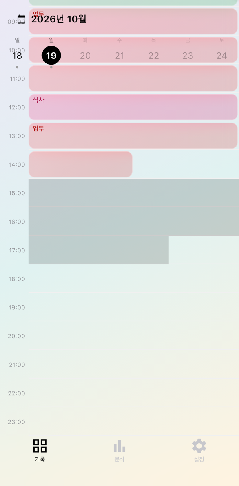
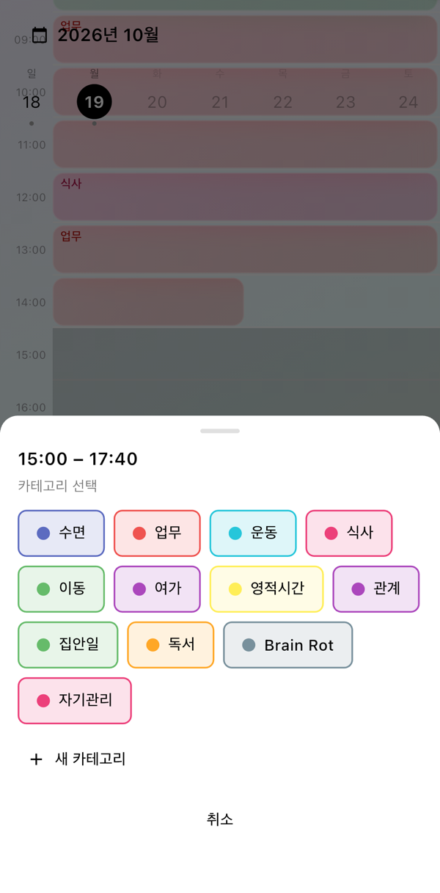
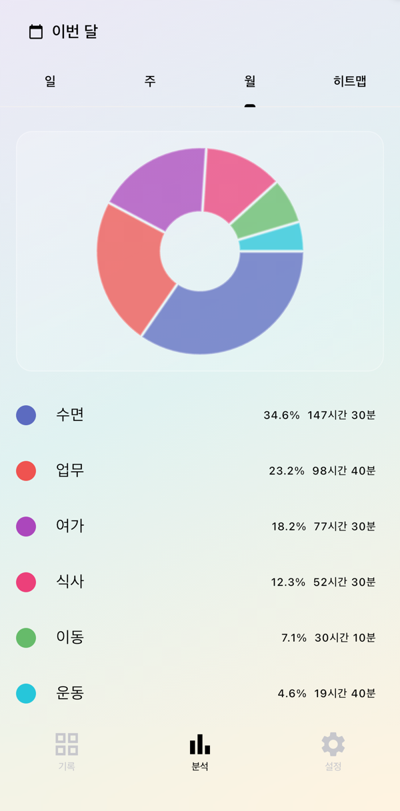
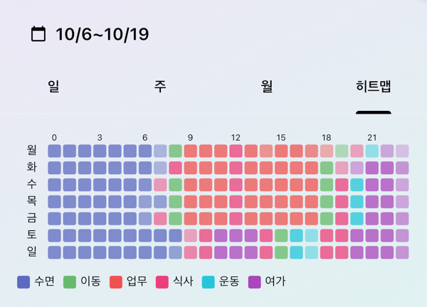

# Time Tracker

**Log your day after the fact — no timers, no friction.**
A Flutter app that shows your day as a 10-minute grid. Long-press and drag across the hours you spent on something, tap a category, done. Analytics turn those blocks into daily/weekly/monthly patterns.

[한국어 README](README.ko.md)

## Why

Most time trackers want you to start and stop a timer for every activity, so people quit after a few days. Time Tracker flips that: you fill in the past whenever you remember, in a few gestures, with camera-roll photos placed on the grid to jog your memory.

## Screenshots

| Drag to select a range | Pick a category | Analytics (monthly stats &amp; heatmap) |
|:---:|:---:|:---:|
|  |  | <br> |

## Features

- **10-minute grid** — 144 cells (24 rows × 6) show the whole day at a glance
- **Long-press drag selection** — separates scrolling from selecting without a mode switch, with haptic feedback ([ADR 0001](docs/adr/0001-long-press-drag-selection.md))
- **One-tap categories** — bottom sheet with presets (sleep, work, exercise, meals, commute, leisure) and inline creation of new ones
- **Automatic block merge** — adjacent blocks with the same category collapse into one ([ADR 0002](docs/adr/0002-block-merge-on-same-category.md))
- **Photo thumbnails** — camera-roll photos appear in the cells matching when they were taken
- **Date navigation** — swipe between days, week strip, and calendar modal
- **Analytics** — daily / weekly / monthly category breakdowns and an hour-of-day heatmap
- **Gap reminders** — local notification when nothing has been logged for 3+ waking hours
- **Local-first, optional cloud sync** — SQLite on-device with no account; Google sign-in enables Supabase sync with last-write-wins conflict resolution

## Tech Stack

| Layer | Libraries |
|---|---|
| UI / state | Flutter, Riverpod |
| Persistence | sqflite (SQLite) |
| Cloud sync & auth | supabase_flutter, google_sign_in |
| Photos | photo_manager |
| Charts | fl_chart, table_calendar |
| Notifications | flutter_local_notifications, timezone |
| Prefs | shared_preferences |

## Architecture

```
src/lib/
├── features/            # Screens + view models
│   ├── grid/            #   GridScreen, GridCoordinator, gesture handler, bottom sheets
│   ├── analytics/       #   AnalyticsEngine (aggregation), AnalyticsScreen
│   └── settings/
└── core/
    ├── logic/           # Pure reducers: DragSelection, BlockReplace, GridLayout, PageSync
    ├── db/              # TimeBlockStore, CategoryStore, schema/migrations, sync metadata
    ├── services/        # BlockMutationService, CategoryManager, photo library, prefs ports
    ├── sync/            # Cloud pull/push with LWW, SyncService orchestration
    ├── auth/            # AuthPort (guest / Supabase + Google)
    ├── notifications/   # NotificationScheduler (waking-hours gap detection)
    └── models/ theme/ utils/
```

Design principles:

- **Pure logic, thin widgets** — gesture → selection, block replacement/merge, and grid layout live in pure functions/reducers under `core/logic`, so they are unit-tested without a widget tree.
- **Ports & adapters** — notifications, preferences, photos, auth and cloud sync are behind interfaces; the app runs fully offline with guest ports when no Supabase config is provided.
- **Single source of truth for navigation** — `GridCoordinator` owns the selected date, page and scroll, removing feedback loops between swipe and header state.
- **Decisions are recorded** — see [`docs/adr/`](docs/adr/), the domain glossary in [`CONTEXT.md`](CONTEXT.md), and the original [`PRD.md`](PRD.md).

~300 unit and widget tests cover reducers, stores, analytics, sync and the grid coordinator.

## Getting Started

Requires Flutter (Dart SDK ^3.12) and an iOS simulator / Android emulator or device.

```bash
cd src
flutter pub get
flutter run
```

Runs in guest mode (local only) by default. To enable cloud sync, pass Supabase/Google config via `--dart-define` — see [`docs/supabase-cloud-sync.md`](docs/supabase-cloud-sync.md).

```bash
cd src
flutter analyze
flutter test
```
